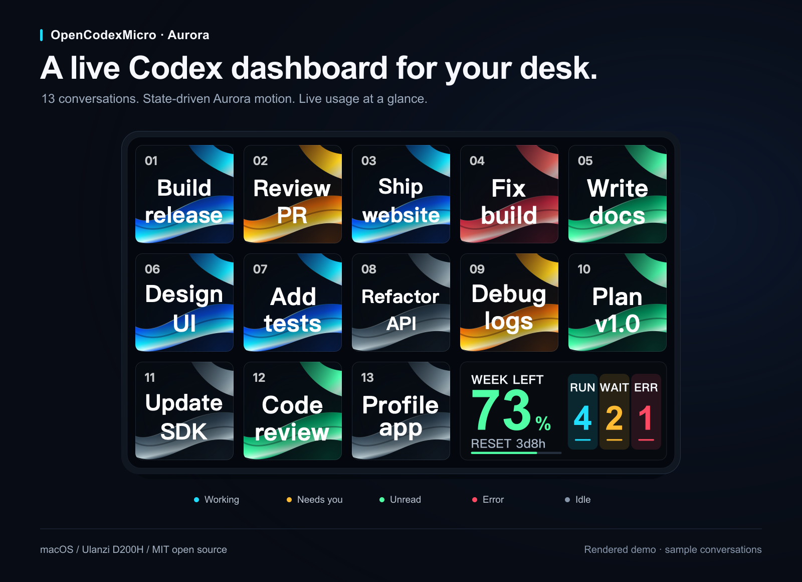
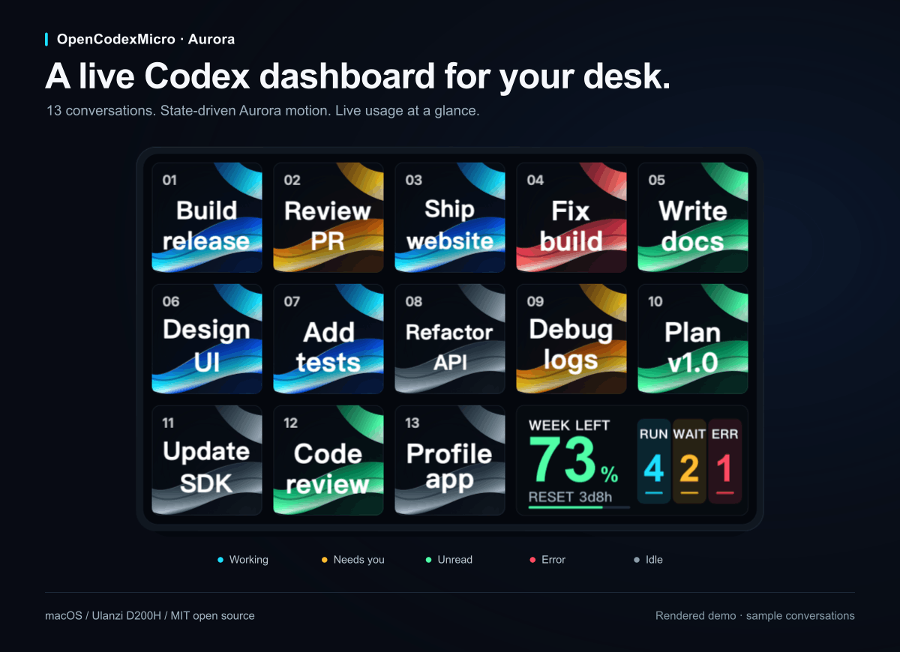

# OpenCodexMicro · Aurora

### 把 Codex 会话状态，放到触手可及的桌面上。

**13 个独立对话格、状态驱动的极光动画、长条屏上的剩余额度与 AI 活动。** 把 Ulanzi Deck Dock D200H 变成 Codex Desktop 的桌面控制台。

[English](README.md) · [下载发行版](https://github.com/RickeyRen/OpenCodexMicro-Aurora/releases) · [反馈问题](https://github.com/RickeyRen/OpenCodexMicro-Aurora/issues)



*使用真实渲染代码生成的演示，包含示例会话和示例额度，不包含用户真实对话。*

## 一眼看清哪里需要你

蓝色流动表示正在运行，琥珀色提示等待输入或批准，绿色表示有未读的完成结果，红色表示异常，暗色表示空闲。相同状态始终使用相同颜色；点按直接进入对应对话。



| 功能 | 实际效果 |
| --- | --- |
| 13 个独立对话 | 显示真实会话标题，支持两行短名、固定会话编号和本机别名 |
| 极光丝带动效 | 原创 Aurora Silk 光绸，不同状态有不同颜色与运动节奏 |
| 独立长条概览 | 大号剩余额度百分比、重置倒计时、运行／等待／异常数量，不占用对话格 |
| 精确跳转 | 前 6 格使用原生 Micro 路由，7–13 格使用已验证的侧栏适配器 |
| 额外控制 | 可在其他页面使用 Fast、Usage、Pin、New、Fork、Steer、Mic、Submit 和旋钮滚动 |
| 本机连接 | Ulanzi Studio 继续管理硬件，Bridge 通过回环地址连接官方桌面应用 |

这是 **RickeyRen 独立维护的 MIT 开源 fork**，基于 [UlanziTechnology/OpenCodexMicro](https://github.com/UlanziTechnology/OpenCodexMicro)，原作者为 [Nian Liu](https://github.com/He11oLiu)。本版本不代表 OpenAI 或 Ulanzi 官方发布、背书或支持。[完整署名与责任范围](NOTICE.md)。

## 首版兼容范围

| 项目 | 已验证范围 |
| --- | --- |
| 电脑 | macOS 13+、**Apple Silicon**；预编译字形程序为 arm64 |
| 硬件 | **Ulanzi Deck Dock D200H**，已完成实机验证 |
| Ulanzi Studio | **3.4.4**；长条屏兼容通道在其他版本自动停用 |
| 官方桌面应用 | 需要可用的 Micro 状态接口；已验证 ChatGPT/Codex 26.1013.40934 |
| 手动安装与开发 | Node.js 20+，推荐 Node 22 |

桌面适配使用内部接口，官方更新后可能需要跟进。Intel Mac、其他设备、Windows 和 Linux 尚未验证；长条功能需主动启用。[限制说明](docs/configuration.md)。

## 安装

### 安装插件与 Bridge

保存工作并**正常退出 Ulanzi Studio**，再执行以下命令。也可以下载 [Releases](https://github.com/RickeyRen/OpenCodexMicro-Aurora/releases) 中的 macOS arm64 ZIP，解压后从该文件夹执行 `npm ci` 及后续步骤。

```bash
git clone https://github.com/RickeyRen/OpenCodexMicro-Aurora.git
cd OpenCodexMicro-Aurora
npm ci
npm run install:plugin
npm run setup
```

仓库包含预编译插件，不需要 `sudo`。安装程序写入用户目录下的 `Codex Bridge.app`、独立 Bridge 后台服务和 Studio 插件。Aurora 沿用上游 UUID，会**替换已经安装的 Codex Micro 插件**；切换版本前请导出 Studio 配置。

重新打开 Studio。保存工作并**正常退出直接启动的 ChatGPT/Codex**，再运行：

```bash
open "$HOME/Applications/Codex Bridge.app"
npm run doctor -- --lang zh
```

**为什么需要启动器？** 它为官方桌面应用添加仅本机可访问的调试连接参数，不修改官方程序、不替换官方更新器，也不提供改版 ChatGPT。已有实例运行时，它会停止并提示你手动退出。需要设备状态时从 Bridge 启动；普通启动不会开启连接。

### 放置 13 个对话格

在 Studio 的 **Codex Micro · Aurora** 中，把 **Codex Task 1–13** 依次放入 D200H 的 13 个小格，保留右下角原生长条窗口。桌面应用中需要已有会话；不足 13 个时，多余格子保持空白。

选中小格可设置本机短名，例如“网站首页”或“接口修复”，不会修改真实会话标题。小编号会跟随对话，帮助区分重名会话。

### 启用右下长条

在 Studio 中选中右下角原生窗口，切换为**纯背景**并清空图片，再执行：

```bash
npm run setup:overview -- --enable --lang zh
```

命令会发现本机页面，验证 13 个动作、长条模式和 Studio 版本，仅写入本机启用配置，不修改 Studio 页面。发现多个候选页面时，用 `--profile` 显式指定。[长条配置与停用说明](docs/configuration.md#native-wide-overview)。

额度默认每 **30 秒**尝试刷新，实际新鲜度受官方应用缓存影响；仅显示应用实际返回的额度窗口，缺失、过期或离线时会明确提示，不会虚构余额。

### 使用 Agent 安装

让 Agent 先阅读 [AGENTS.md](AGENTS.md)，检查已安装插件，再按需使用 [插件安装 skill](skills/install-ulanzi-studio-plugin/SKILL.md) 和 [Bridge 设置 skill](skills/setup-codex-bridge/SKILL.md)。插件与 Bridge 需要分别验证；未经用户明确许可，不能退出或更改 ChatGPT 的启动方式。

## 隐私与安全

无需 API Key 或自建云端。项目不增加云端数据上传服务；Bridge 只监听 `127.0.0.1`，官方 ChatGPT/Codex 原有网络行为仍然适用。

CDP 能读取并控制桌面应用，**回环地址不能隔离其他本机进程**。不要使用隧道、反向代理或局域网监听暴露端口。Bridge 会在处理路由之前拒绝浏览器来源及浏览器 Fetch Metadata，并兼容 Node fetch 默认请求头。[安全说明](SECURITY.md)。

## 开发与贡献

```bash
npm ci
npm --prefix integration/com.ulanzi.codexmicro.ulanziPlugin ci
npm run check
npm run build:media
npm run package:release
```

完整验证会构建 Bridge、原生字形程序、动画与插件，并通过隔离环境测试；不会安装或重启当前应用。构建字形程序需要 macOS 的 Apple Command Line Tools。

[配置说明](docs/configuration.md) · [更新与卸载](docs/setup-and-operations.md) · [更新日志](CHANGELOG.md) · [参与贡献](CONTRIBUTING.md)

如果它帮你少切几次窗口，欢迎 Star，让更多 Codex 用户找到它。也欢迎提交硬件兼容反馈和聚焦的小型 PR。

## 许可与署名

[MIT License](LICENSE)。保留原作者 Nian Liu 的版权和上游 Ulanzi 集成署名；Aurora 修改由本 fork 独立维护。[责任说明](NOTICE.md) · [第三方许可](THIRD_PARTY_NOTICES.md)。
